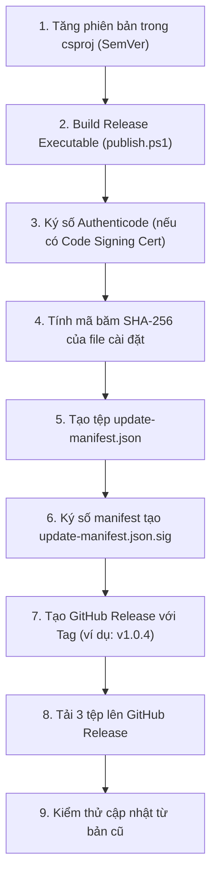

# HƯỚNG DẪN QUY TRÌNH PHÁT HÀNH BẢN CẬP NHẬT (UPDATE GUIDE)
## GIANG DEV DISK ANALYZER PRO | GITHUB RELEASES AUTO UPDATE

Tài liệu này cung cấp quy trình chuẩn từng bước (SOP) dành cho chủ dự án và đội ngũ phát triển để chuẩn bị, ký số, đóng gói và phát hành một phiên bản mới qua GitHub Releases một cách an toàn và bảo mật tuyệt đối.

---

## 1. CÁC TÀI SẢN PHÁT HÀNH BẮT BUỘC (RELEASE ASSETS)

Mỗi bản phát hành chính thức (Stable Release) trên GitHub cần có 3 tệp đính kèm:

| Tên tệp | Mô tả | Vai trò bảo mật |
| :--- | :--- | :--- |
| **`GIANG-DEV-DISK-ANALYZER-PRO-Setup.exe`** | Gói cài đặt hoặc tệp thực thi độc lập (win-x64) | Chứa phần mềm bản mới. Khuyến nghị ký Authenticode. |
| **`update-manifest.json`** | Tệp mô tả siêu dữ liệu bản cập nhật | Ràng buộc phiên bản, kiến trúc, min version và mã SHA-256 của gói cài đặt. |
| **`update-manifest.json.sig`** | Tệp chữ ký số mật mã học Base64 | Chữ ký số ECDSA (NIST P-256) được ký bởi Khóa riêng của chủ dự án. |

---

## 2. QUY TRÌNH PHÁT HÀNH TỪNG BƯỚC (STEP-BY-STEP)



---

### Bước 1: Tăng phiên bản ứng dụng (SemVer)
Mở tệp `src/GIANG.Dev.DiskAnalyzer.App/GIANG.Dev.DiskAnalyzer.App.csproj` và cập nhật:
```xml
<PropertyGroup>
    <Version>1.0.4</Version>
    <AssemblyVersion>1.0.4.0</AssemblyVersion>
    <FileVersion>1.0.4.0</FileVersion>
</PropertyGroup>
```

---

### Bước 2: Đóng gói bản cài đặt Release
Chạy kịch bản xuất bản độc lập cho kiến trúc Windows 64-bit:
```powershell
powershell -ExecutionPolicy Bypass -File .\scripts\publish.ps1
```
Tệp thực thi đầu ra: `publish/win-x64/GIANG.Dev.DiskAnalyzer.App.exe`  
Đổi tên tệp (hoặc đóng gói bộ cài Inno Setup / WiX) thành: `GIANG-DEV-DISK-ANALYZER-PRO-Setup.exe`.

---

### Bước 3: Ký số Authenticode (Nếu có chứng thư số)
Nếu bạn sở hữu Chứng thư ký số (EV / OV Code Signing Certificate):
```powershell
signtool.exe sign /tr http://timestamp.digicert.com /td sha256 /fd sha256 /a "publish\win-x64\GIANG-DEV-DISK-ANALYZER-PRO-Setup.exe"
```

---

### Bước 4: Tính mã băm SHA-256 của tệp cài đặt
Chạy lệnh PowerShell để lấy mã băm:
```powershell
$hash = (Get-FileHash -Algorithm SHA256 "publish\win-x64\GIANG-DEV-DISK-ANALYZER-PRO-Setup.exe").Hash.ToLowerInvariant()
Write-Host "Mã SHA-256: $hash"
```

---

### Bước 5: Tạo tệp `update-manifest.json`
Tạo tệp `publish/win-x64/update-manifest.json` với cấu trúc mẫu:
```json
{
  "version": "1.0.4",
  "assetName": "GIANG-DEV-DISK-ANALYZER-PRO-Setup.exe",
  "architecture": "win-x64",
  "sha256": "dán_mã_băm_sha256_tính_được_ở_bước_4_vào_đây",
  "minSupportedVersion": "1.0.0",
  "releaseUrl": "https://github.com/YOUR_GITHUB_USERNAME/GIANG-DEV-DISK-ANALYZER-PRO/releases/tag/v1.0.4",
  "releaseDate": "2026-10-28T16:00:00Z",
  "changelogSummary": "Cải tiến tốc độ quét, bổ sung tính năng cập nhật tự động an toàn qua GitHub Releases và giao diện Cyberpunk mới."
}
```

---

### Bước 6: Ký số Manifest bằng Khóa riêng ECDSA
Sử dụng script PowerShell sau để ký số tệp `update-manifest.json`:

```powershell
# Script ký số Manifest bằng ECDSA NIST P-256
$manifestPath = "publish\win-x64\update-manifest.json"
$privateKeyPemPath = "path\to\your_private_key.pem" # Chỉ lưu trữ trên máy cá nhân an toàn của chủ dự án!

# Đọc manifest bytes
$manifestBytes = [System.IO.File]::ReadAllBytes($manifestPath)

# Nạp private key ECDSA và ký SHA-256
$ecdsa = [System.Security.Cryptography.ECDsa]::Create()
$ecdsa.ImportFromPem([System.IO.File]::ReadAllText($privateKeyPemPath))
$signatureBytes = $ecdsa.SignData($manifestBytes, [System.Security.Cryptography.HashAlgorithmName]::SHA256)

# Xuất tệp chữ ký Base64
$signatureBase64 = [Convert]::ToBase64String($signatureBytes)
[System.IO.File]::WriteAllText("publish\win-x64\update-manifest.json.sig", $signatureBase64)
Write-Host "Đã ký số thành công: update-manifest.json.sig"
```

> [!CAUTION]
> **QUY TẮC BẢO MẬT KHÓA:**  
> Tuyệt đối **KHÔNG BAO GIỜ** đẩy tệp Private Key (`*.pem`, `*.pfx`, `*.key`) lên Git, GitHub hoặc nhúng vào trong mã nguồn. Chỉ Khóa công khai (Public Key) mới được đưa vào `GitHubUpdateOptions.cs`.

---

### Bước 7: Tạo GitHub Release
1. Truy cập: `https://github.com/YOUR_GITHUB_USERNAME/GIANG-DEV-DISK-ANALYZER-PRO/releases/new`
2. **Tag version:** `v1.0.4`
3. **Release title:** `GIANG DEV DISK ANALYZER PRO v1.0.4 (Stable)`
4. **Description:** Ghi rõ nội dung thay đổi (Changelog / Release Notes).
5. **Cấu hình tùy chọn:**
   - Đảm bảo **BỎ CHỌN** `Set as a pre-release` (để ứng dụng nhận diện là bản Stable).
   - Đảm bảo **BỎ CHỌN** `Set as a draft` (chỉ xuất bản chính thức).

---

### Bước 8: Đính kèm tài sản phát hành (Attach Assets)
Kéo thả 3 tệp sau vào mục **Attach binaries by dropping them here or selecting them**:
1. `GIANG-DEV-DISK-ANALYZER-PRO-Setup.exe`
2. `update-manifest.json`
3. `update-manifest.json.sig`

Nhấn **Publish release**.

---

### Bước 9: Kiểm thử xác minh từ ứng dụng
1. Mở phiên bản cũ `v1.0.3`.
2. Truy cập mục **Cập nhật** trên Sidebar.
3. Bấm **KIỂM TRA CẬP NHẬT**: Ứng dụng sẽ hiển thị phiên bản mới `v1.0.4`, ghi chú phát hành và dung lượng.
4. Bấm **TẢI XUỐNG VÀ CẬP NHẬT**: Theo dõi tiến trình tải xuống, tốc độ mạng và kiểm tra xác minh SHA-256 & chữ ký số.
5. Bấm **CÀI ĐẶT NGAY**: Hộp thoại xác nhận hiển thị; người dùng nhấn "Yes" để đóng ứng dụng và khởi chạy trình cài đặt.
