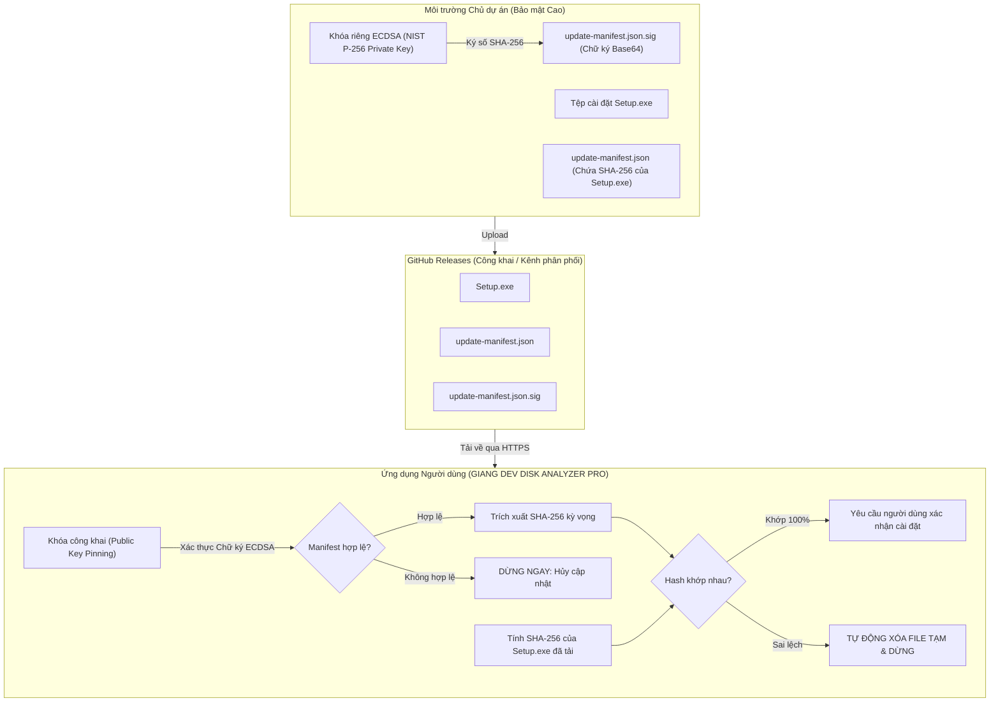

# MÔ HÌNH BẢO MẬT & XÁC THỰC CHỮ KÝ SỐ (UPDATE SECURITY ARCHITECTURE)
## GIANG DEV DISK ANALYZER PRO

Tài liệu này phân tích chi tiết kiến trúc an toàn, mô hình mật mã học, quản lý khóa và các biện pháp bảo vệ chống giả mạo được triển khai trong hệ thống **GitHub Auto Update**.

---

## 1. MÔ HÌNH MẬT MÃ HỌC (CRYPTOGRAPHIC MODEL)

---

## 2. BẢNG MA TRẬN MỐI ĐE DỌA & GIẢI PHÁP PHÒNG THỦ (THREAT MATRIX)

| Mối đe dọa (Threat) | Mức độ rủi ro | Cơ chế phòng thủ được triển khai |
| :--- | :---: | :--- |
| **Tấn công nghe lén & can thiệp (MitM)** | 🔴 Rất cao | 100% kết nối sử dụng HTTPS với chứng thư TLS mặc định của Windows. Từ chối mọi liên kết `http://`. |
| **Máy chủ tải về độc hại (Untrusted Host)** | 🔴 Rất cao | Danh sách máy chủ được duyệt (Host Whitelist): Chỉ chấp nhận tải từ các tên miền chính thức của GitHub (`github.com`, `objects.githubusercontent.com`). Bất kỳ domain nào khác đều kích hoạt ngoại lệ an toàn. |
| **Sửa đổi tệp manifest (Manifest Tampering)** | 🔴 Rất cao | Chữ ký số mật mã học **ECDSA NIST P-256** với thuật toán băm SHA-256. Bất kỳ thay đổi nào dù chỉ 1 ký tự trong manifest đều làm chữ ký không hợp lệ và hủy tiến trình ngay lập tức. |
| **Gói cài đặt bị sửa đổi (Payload Tampering)** | 🔴 Rất cao | So sánh mã băm SHA-256 được tính toán trực tiếp từ tệp cài đặt với mã băm trong manifest đã được ký số. Nếu sai lệch, **tệp cài đặt lập tức bị xóa vĩnh viễn khỏi thư mục tạm**. |
| **Tấn công hạ cấp (Downgrade / Replay Attack)** | 🟠 Cao | Bộ so sánh Semantic Versioning (`VersionComparisonService`) chỉ chấp nhận phiên bản ứng viên lớn hơn nghiêm ngặt (`candidate > current`). Bản phát hành cũ hơn hoặc bằng phiên bản hiện tại bị từ chối tự động. |
| **Tấn công tràn đĩa / Stream vô tận** | 🟠 Cao | Giới hạn dung lượng tải tối đa cố định (`MaxDownloadSizeBytes = 500 MB`). Tự động ngắt kết nối và xóa tệp nếu dung lượng tải vượt quá hạn mức. |
| **Thực thi mã tùy ý (RCE via Scripts)** | 🔴 Nghiêm trọng | Không thực thi bất kỳ tệp script (`.bat`, `.cmd`, `.ps1`) hoặc tệp nén không xác định. Chỉ cho phép gọi trực tiếp tệp cài đặt định dạng `.exe` hoặc `.msi`. |
| **Cài đặt ngầm / Chiếm quyền trái phép** | 🟠 Cao | Tuyệt đối **không tự ý cài đặt** hoặc khởi động lại mà không có sự cho phép. Bắt buộc người dùng nhấn xác nhận trong hộp thoại Windows trước khi kích hoạt trình cài đặt. |

---

## 3. QUẢN LÝ VÀ BẢO VỆ KHÓA MẬT MÃ HỌC (KEY MANAGEMENT)

### Khóa riêng (Private Key):
- Được sinh ra bằng thuật toán đường cong elliptic NIST P-256 (secp256r1).
- **Lưu trữ:** Lưu ngoại tuyến trong phần cứng an toàn (YubiKey / TPM) hoặc tệp được mã hóa bằng mật khẩu mạnh chỉ chủ dự án biết.
- **Quy tắc vàng:** Không bao giờ đưa Khóa riêng lên Git, không commit vào repository, không chia sẻ qua chat hoặc lưu trữ trên máy chủ CI không được bảo vệ.

### Khóa công khai (Public Key):
- Được trích xuất dưới định dạng chuẩn `SubjectPublicKeyInfo` (SPKI) mã hóa Base64.
- Nhúng cố định vào cấu hình ứng dụng (`GitHubUpdateOptions.cs`).
- Ứng dụng chỉ sử dụng khóa này để kiểm tra tính toàn vẹn (hàm `VerifyData`), hoàn toàn không thể dùng để giả mạo chữ ký.

---

## 4. BẢO VỆ DỮ LIỆU NGƯỜI DÙNG KHI CẬP NHẬT

Khi quá trình cập nhật diễn ra:
1. Gói cài đặt được tải về thư mục tạm riêng biệt: `%TEMP%\GiangDevDiskAnalyzer\Updates`.
2. Không ghi đè hoặc can thiệp trực tiếp vào thư mục cài đặt gốc khi phần mềm đang hoạt động.
3. Cơ sở dữ liệu SQLite lịch sử quét (`scan_history.db`) và tệp cấu hình người dùng (`settings.json`) nằm trong thư mục `%APPDATA%\GiangDevDiskAnalyzer` được giữ nguyên vẹn 100%.
4. Nếu người dùng hủy tải hoặc quá trình xác minh thất bại, hệ thống tự động xóa sạch các tệp tạm đã tải về.
